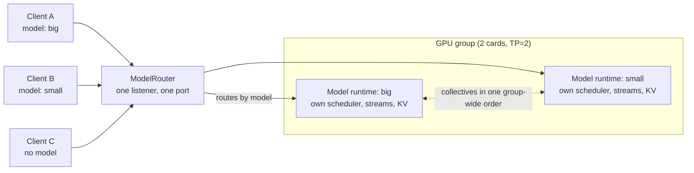
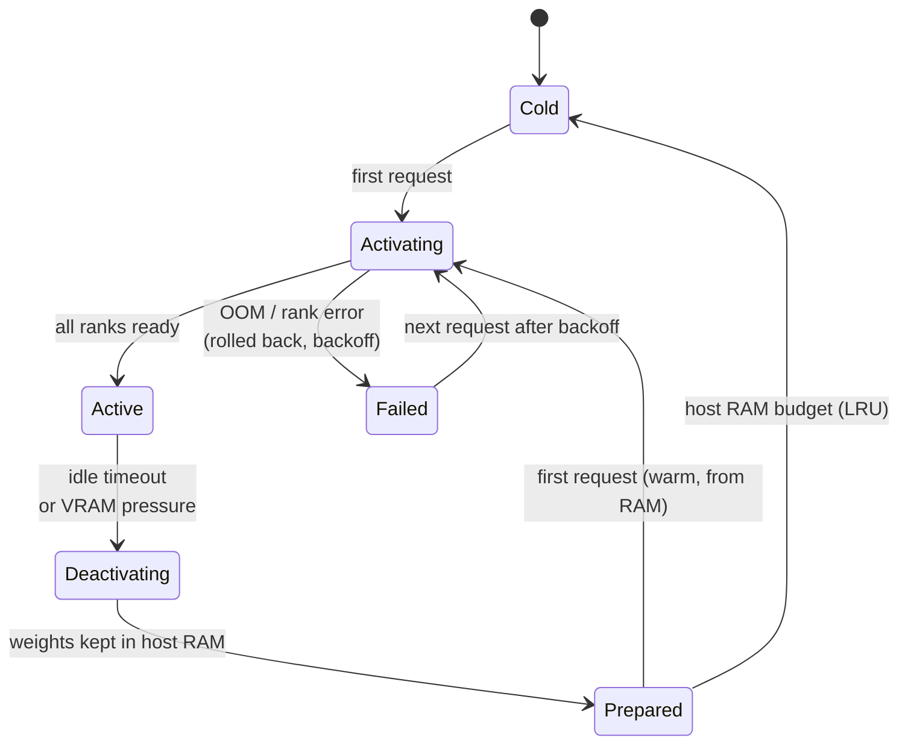
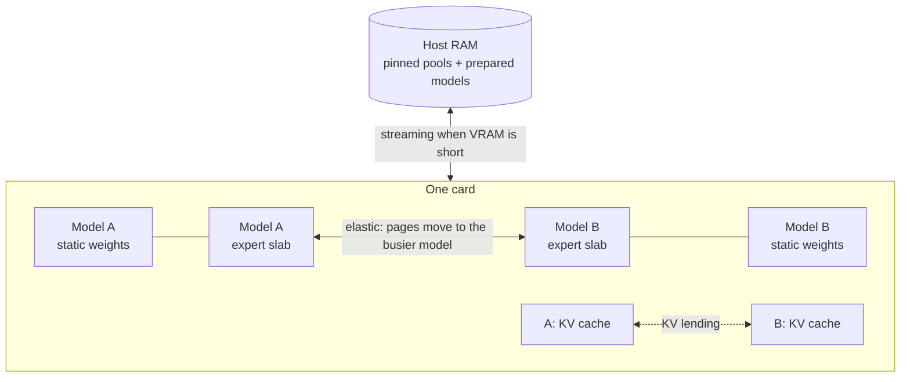

# RadianceSwap

**Multi-model serving for [Radiance](https://codeberg.org/StillDeadcode/radiance).** One process, one
endpoint, several models sharing the same GPU group. Models load on their first request, unload when
idle, and hand VRAM to each other while they run.

RadianceSwap is an experimental branch of Radiance. Without `--manifest` it behaves exactly like
upstream Radiance; everything below only applies in manifest mode.

> Status: experimental, looking for testers. Measured on 2× AMD Radeon AI PRO R9700 (gfx1201, TP=2).

**Whitepaper:** [*RadianceSwap: In-Process Multi-Model LLM Serving with Dynamic VRAM Sharing*](docs/paper/RadianceSwap-Whitepaper.pdf)
(PDF, 8 pages): design, evaluation, the defects found in acceptance, and a comparison with llama-swap.

---

## How it works

### One endpoint, many models



- The router reads the request's `model` field **before** tokenizing, so each request uses its own
  model's tokenizer, chat template, grammar and limits. No `model` goes to the default model; an
  unknown id is a 404.
- Every active model is its own runtime and runs **in parallel** with the others. A process-wide
  sequencer gives all models' all-reduces one order on every rank, so two models can never block
  each other.

### Model lifecycle



- **Cold:** nothing loaded. Activation reads the model from disk.
- **Prepared:** VRAM freed, weights kept in host RAM in GPU-ready form. The next activation skips
  parsing, relayout and disk reads.
- **Active:** serving. A running generation is **never** interrupted. Deactivation waits for it.
- **Failed:** every partial allocation on every rank is released. Other models keep running. Retries
  back off. A device error marks the whole group unhealthy instead of retrying forever.

### Sharing VRAM between active models



Free VRAM is handed out in this order: **static weights → KV cache → experts**.

| Mechanism | What it does |
|---|---|
| **Group heat planner** | Splits the expert budget across active models by expert heat, weighted by bytes, with a minimum share per model |
| **Elastic expert slab** | Expert VRAM is mapped in ~128 MiB chunks. A model that cools down gives chunks back **physically**, and a busier model maps them |
| **Cross-model KV lending** | A model with waiting sequences grows its KV cache into bytes another model's slab released. Running sequences are never evicted |
| **Static-weight streaming** | If a model's non-expert weights don't fit, it still starts and reads them over PCIe (zero-copy for decode, staged ring for prefill). Output is bit-identical. As soon as VRAM frees up, the weights move onto the card |
| **Heat warm-up** | A deactivated model keeps its expert heat. On re-activation the hottest experts are loaded first, within a byte budget |
| **Host RAM budget** | Prepared models, store copies, host pools and staging share one budget. Over the limit, the least recently used prepared model goes cold. If it still doesn't fit, the activation is refused with a 503 instead of the kernel's OOM killer stepping in |

---

## Quick start

`models.json`:

```json
{
  "gpu_group": { "devices": [0, 1], "tp": 2 },
  "cache": { "idle_timeout_ms": 300000 },
  "models": [
    { "id": "big",   "path": "/models/big-moe.rad", "default": true,
      "engine": ["--placement", "expert_tiered", "--max-model-len", "16384"] },
    { "id": "small", "path": "/models/small",
      "engine": ["--max-model-len", "16384"] }
  ]
}
```

```sh
radiance --manifest models.json --port 8000

curl localhost:8000/v1/chat/completions -H 'Content-Type: application/json' \
  -d '{"model": "small", "messages": [{"role": "user", "content": "hi"}]}'
```

- `engine` takes the usual Radiance options for each model and goes through the same validation as
  the command line.
- `cache` also takes `host_budget_mib`, `max_active_models`, `max_queued_requests`,
  `warmup_budget_mib`, and backoff settings.
- `/v1/models` lists every configured model. `/radiance/models` shows each model's state, VRAM and
  RAM use, and streamed share. `/metrics` exports the same per model.

Full reference: [`docs/GUIDE.md`](docs/GUIDE.md) §4.12.

---

## What it costs

Measured on 2× R9700, TP=2. All numbers and setups are in
[`docs/swap/gpu-acceptance.md`](docs/swap/gpu-acceptance.md).

| Situation | Result |
|---|---|
| Manifest with one model vs. plain `--model` | no measurable difference (−0.3 % … +0.1 %) |
| Switching between two **already active** models | free: 0 ms activation, < 1 ms queue |
| First request to a cold dense model (0.8B) | ~2.0 s (activation) |
| Warm re-activation from RAM | dense ~2.1 s, MoE ~60 s (cold from disk: ~70 s) |
| Two models busy at the same time | each gets ~½ its decode speed; total throughput stays about the same |
| 120 activate/deactivate cycles | VRAM back to baseline every time, no leak |
| Streaming 85 % of static weights (dense 0.8B) | C1 330 → 32 tok/s; recovers in 1–2 s once VRAM frees up |
| Output vs. `--model` | identical: greedy, seeded sampling, streaming, MTP, abort |

Time to first token is reported per request, split into queue, activation and prefill.

---

## Known limitations

- **One TP size per GPU group.** All models in a manifest use the group's TP. Plugins that only run
  with `--tp 1` (e.g. LFM2) can't join a TP=2 group yet.
- **A cold model still reserves a VRAM share.** A large MoE can be ~9 % slower even if the second
  model never activates ([#56](https://github.com/Code000-211/RadianceSwap/issues/56)). Workaround:
  set `--gpu-headroom-mib` per model.
- **Large MoEs need a lot of host RAM.** A warm copy of the active model's weights stays in RAM: one
  Qwen3.8-Flash-Next active and prepared uses ~153 of 170 GiB.
- **Not supported in manifest mode:** LoRA adapters, and the multimodal / audio / video endpoints.
  Single-model mode is unchanged.
- **Narrow test coverage.** Tested only with one MoE (Qwen3.8-Flash-Next) and small dense models.
  A long-run check for non-finite logits on the elastic slab is still open
  ([#58](https://github.com/Code000-211/RadianceSwap/issues/58)).

---

## Build

Same as upstream Radiance: Linux, a C++20 compiler, CMake 3.21+, Ninja, ROCm for the device kernels.

```sh
git clone https://github.com/Code000-211/RadianceSwap.git && cd RadianceSwap
./build.sh                  # configure, build for the cards present, run the fast tests
```

Building, Docker images and all single-model options are documented in
[`docs/GUIDE.md`](docs/GUIDE.md) and [`docs/DOCKER.md`](docs/DOCKER.md).

## Documentation

| Document | Contents |
|---|---|
| [`docs/paper/RadianceSwap-Whitepaper.pdf`](docs/paper/RadianceSwap-Whitepaper.pdf) | Whitepaper: design, evaluation, defects, related work |
| [`docs/GUIDE.md`](docs/GUIDE.md) §4.12 | Manifest reference, lifecycle, RAM/VRAM sizing, metrics |
| [`docs/swap/gpu-acceptance.md`](docs/swap/gpu-acceptance.md) | Every GPU measurement |
| [`docs/swap/`](docs/swap/) | Design notes: elastic slab, KV lending, static streaming, host budget, heat warm-up |
| [`docs/adr/`](docs/adr/) | Design decisions (in-process switching, several active models, parallel runtimes) |
| [`GLOSSARY.md`](GLOSSARY.md), [`SPEC.md`](SPEC.md) | Terms and the original spec |

## Testing and feedback

Bug reports are very welcome. Please open an issue with your manifest and command line, your
GPU(s) and ROCm version, the server log, and what you expected vs. what happened.

## License

RadianceSwap is a derivative of [radiance](https://codeberg.org/StillDeadcode/radiance) and is
distributed under the original license: [Apache-2.0](LICENSE), copyright Deadcode and the radiance
contributors. Keep [`NOTICE`](NOTICE) with any copy or derivative. It credits the authors and lists
the MIT-licensed code the tree includes. Model weights are not covered: each keeps the license of
the model it was converted from. The Docker image also holds third-party libraries under their own
licenses, GPL and LGPL among them; `/usr/share/doc/THIRD-PARTY` in the image lists each one with its
version and source.
