# RadianceSwap: Whitepaper

**Several large language models behind one endpoint, on the same GPUs, without restarting the process.**

> PDF version, written as a technical report with related work and references: [`RadianceSwap-Whitepaper.pdf`](RadianceSwap-Whitepaper.pdf) (LaTeX source in [`tex/`](tex/), build with `make -C docs/whitepaper pdf`).

As of November 2026, code at `86d4503`. Every number comes from
[`docs/swap/gpu-acceptance.md`](../swap/gpu-acceptance.md) and
[`docs/GUIDE.md`](../GUIDE.md) §4.12, measured on 2× AMD Radeon AI PRO R9700 (gfx1201, TP=2),
48 vCPU, 170 GiB RAM.

> **Status: experimental.** Tested on exactly one system, with one MoE model (Qwen3.8-Flash-Next)
> and small dense models. Meant for testing and feedback, not for production.

---

## Contents

1. [Summary](#1-summary)
2. [The problem](#2-the-problem)
3. [The idea in one picture](#3-the-idea-in-one-picture)
4. [Terms](#4-terms)
5. [The path of a request](#5-the-path-of-a-request)
6. [Lifecycle of a model](#6-lifecycle-of-a-model)
7. [Memory: where the weights live](#7-memory-where-the-weights-live)
8. [Sharing VRAM between active models](#8-sharing-vram-between-active-models)
9. [Parallel runtimes and the collective order](#9-parallel-runtimes-and-the-collective-order)
10. [Host RAM: budget and sizing](#10-host-ram-budget-and-sizing)
11. [Measurements](#11-measurements)
12. [How it differs from llama-swap](#12-how-it-differs-from-llama-swap)
13. [Limits and open points](#13-limits-and-open-points)
14. [Quick start](#14-quick-start)
15. [Sources in this repository](#15-sources-in-this-repository)

---

## 1. Summary

- **What:** RadianceSwap is an experimental branch of the inference engine
  [Radiance](https://codeberg.org/StillDeadcode/radiance). With `--manifest`, **one process serves
  several models** through **one** OpenAI-compatible endpoint.
- **How:** A model is **activated by its first request**, **deactivated** when idle, and then stays
  **GPU-ready in host RAM**. Several models can be **active at the same time** and **move VRAM between
  each other at runtime**.
- **Guarantees:** A **running generation is never cut**. Output is **bit-identical** to single-model
  mode with `--model` (checked: greedy, seeded sampling, streaming, MTP, abort).
- **Cost:** With no second model there is no measurable overhead (−0.3 % to +0.1 %). Switching between
  two models that are already active costs 0 ms. Two models busy at the same time each get about
  **half** the decode throughput.
- **Versus llama-swap:** llama-swap is a **proxy that starts and stops server processes**.
  RadianceSwap works **inside the engine** and shares VRAM dynamically, but only works with Radiance.
  Details in [section 12](#12-how-it-differs-from-llama-swap).

---

## 2. The problem

A plain Radiance process serves **exactly one model**. Serving several large models on the same GPUs
left only awkward options:

- **Stop and restart the process:** Every restart parses the checkpoint again and rebuilds layout,
  tokenizer and tapes. For a 113 GiB MoE that takes more than a minute, and the endpoint is gone
  meanwhile.
- **Wait until model A is done:** Under mixed load, a request for model B waits for A's longest
  running generation. The wait is **unbounded**.
- **Abort running generations:** not acceptable.

**Goal:** A request for model B runs **right away**, even while A is busy, and nothing of A is cut.

---

## 3. The idea in one picture

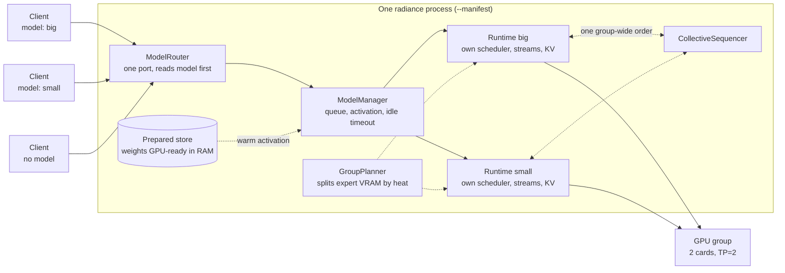

Three building blocks carry the design:

1. **One process instead of many** (ADR 0001): The HTTP listener, the plugin registry and the GPU
   coordination belong to the process. Models come and go as **runtimes** inside it.
2. **Several active models at once** (ADR 0002): They share VRAM. What does not fit is streamed from
   host RAM.
3. **Real parallelism** (ADR 0003): Each runtime has its own streams and threads. Only the
   cross-GPU communication (all-reduce) runs in one shared order.

Without `--manifest`, Radiance behaves **exactly as before**.

---

## 4. Terms

| Term | Meaning |
|---|---|
| **Model** | One base artifact (`.rad` container or HF checkpoint). The unit that gets activated. |
| **GPU group** | The GPUs that compute together with tensor parallelism (TP). All models in a manifest share it. |
| **Active model** | Has a runtime on the GPU group and serves requests. Several at once are possible. |
| **Prepared model** (`prepared`) | Not active; weights sit **GPU-ready** in host RAM. |
| **Cold model** (`cold`) | No copy in RAM. Activation reads from disk. |
| **Activation / deactivation** | A model gains or loses its runtime, without a process restart. |
| **Group heat** | How often each model's experts are routed. Scarce expert VRAM is split by it. |
| **KV lending** | One model's KV cache partition grows into VRAM another model gave back. |
| **RAM streaming** | Weights that do not fit in VRAM are read over PCIe during inference. |

Full list (German): [`GLOSSARY.md`](../../GLOSSARY.md).

---

## 5. The path of a request

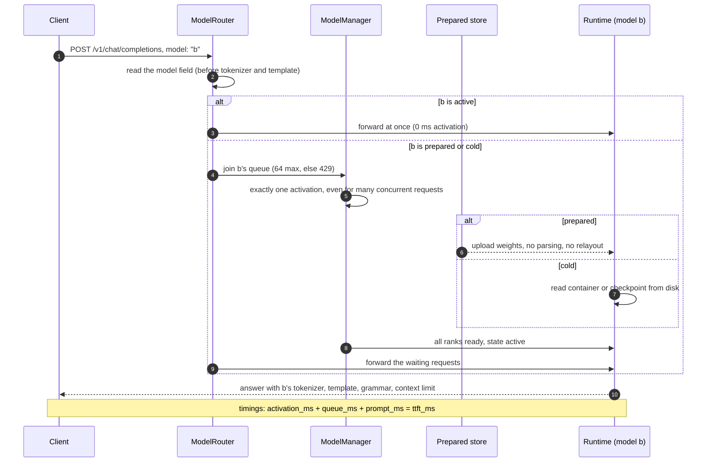

- **Routing before tokenization:** Every request uses the tokenizer, chat template, grammar and
  limits of **its own** model. Mix-ups cannot happen.
- **No `model` field:** goes to the default model. **Unknown id:** 404 `model_not_found`, listing the
  ids served.
- **Image and audio requests** are routed by `model` too (since #59). In manifest mode only
  `/v1/videos` and the WebSocket sessions (`/v1/realtime`, `/v1/audio/speech/stream`) are refused
  with a 501.
- **TTFT is split:** Every response and `/metrics` show separately how long a request waited for
  activation, for the scheduler, and for prefill.

**What a client sees when its model is not ready:**

| Status | Code | When |
|---|---|---|
| 404 | `model_not_found` | the id is not in the manifest |
| 429 | `model_queue_full` | too many requests already wait for this model |
| 503 | `model_activation_failed` | activation failed (the message names the cause) |
| 503 | `model_activation_backoff` | failed recently; `Retry-After` says when to try again |
| 503 | `model_activation_timeout` | not active within 10 minutes |
| 503 | `gpu_group_unhealthy` | device error; the process needs a restart |

---

## 6. Lifecycle of a model

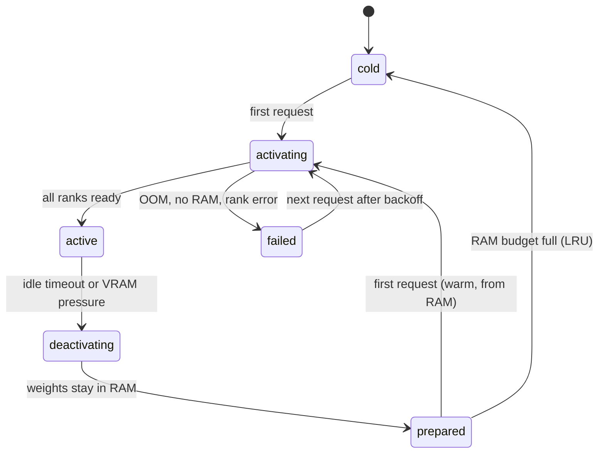

| State | What happens |
|---|---|
| `cold` | Nothing loaded. Activation reads from disk. |
| `prepared` | VRAM freed, weights GPU-ready in RAM. Next activation skips parsing, relayout and disk reads. |
| `activating` | Runs on its own thread. Other models keep serving. New requests wait on the **same** activation. |
| `active` | Serving. **Running generations are never interrupted**; a deactivation waits for them. |
| `deactivating` | Taken out of the route table, runtime being torn down. KV, prefix and recurrent state are gone afterwards; weights and expert heat stay. |
| `failed` | **Every** partial allocation on **every** rank released; other models keep running. Backoff 1 s, doubling up to 60 s. |

**When a model is deactivated:**

- **Idle timeout:** no request for `cache.idle_timeout_ms`. A streaming response counts as load until
  its last chunk.
- **VRAM pressure:** a new model finds the cards full. The model that has been **idle the longest** is
  deactivated. A model that is generating is **never** chosen.
- **Device errors:** mark the whole GPU group `unhealthy` instead of retrying forever.

---

## 7. Memory: where the weights live

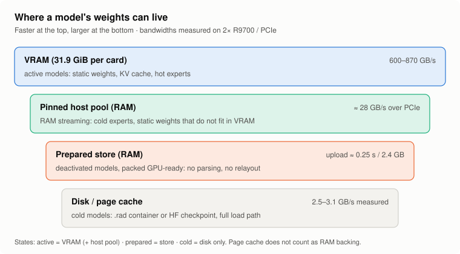

- **The key number:** PCIe delivers **≈ 28 GB/s**, VRAM **600–870 GB/s**. Anything read over PCIe is
  20 to 30 times slower.
- **The prepared store** is why a warm activation is fast: the weights are already in the form the
  kernels read. They are **never dequantized or requantized**.
- **Page cache does not count:** the kernel can take it back at any time. RadianceSwap therefore
  copies weights into its own anonymous memory on purpose.

---

## 8. Sharing VRAM between active models

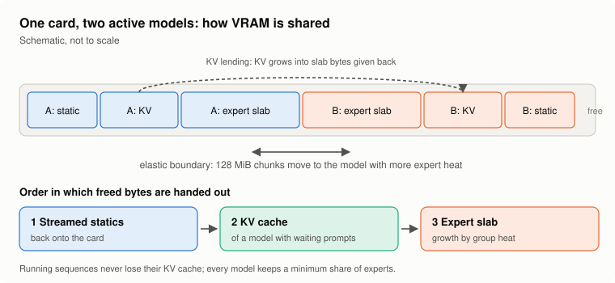

Each model gets a **fixed share** of VRAM when it starts. Inside those shares, memory is moved at
runtime. These mechanisms work together:

| Mechanism | What it does | Result (measured) |
|---|---|---|
| **GroupPlanner** | Splits the expert slots of all MoE models by **group heat × bytes**. Every model keeps a minimum share. | Sum of grants ≤ pool in 7,736 of 7,736 samples |
| **Elastic expert slab** | Expert VRAM in ~128 MiB chunks. An idle model gives chunks back **physically**; a busy one maps them. | ~3 GiB per card moves to the loaded model within 20–30 s |
| **Cross-model KV lending** | The KV partition of a model with waiting prompts grows into slab bytes given back. Running sequences are never evicted. | +468–702 MiB per card under load, back after 13–20 s |
| **Static-weight streaming** | If a model's static weights do not fit, it starts anyway and reads the rest over PCIe. As soon as VRAM frees up, the weights move back. | Activation succeeds with full VRAM; output identical |
| **Heat warm-up** | A deactivated model's expert heat is saved. On re-activation the hottest experts go onto the card first. | Hit rate 83.45 % → **89.12 %** with a 12 GiB budget |

### The elastic slab at work

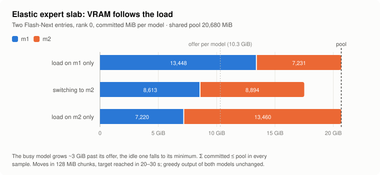

### What streaming costs

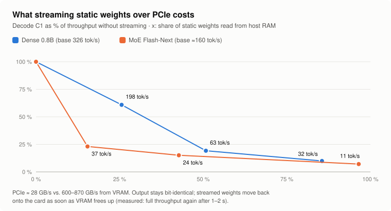

- **How to read this:** streaming is a **bridge, not a steady state** (ADR 0002). It lets a model
  answer **right away** instead of waiting. It only becomes fast once its weights are back in VRAM.
- **Prefill** streams only through a staging ring, never through direct zero-copy access.

---

## 9. Parallel runtimes and the collective order

With TP=2 the two GPUs exchange partial results after every layer (all-reduce). The kernels busy-wait
on a flag from the other side. With two models running at once, GPU 0 could wait on model A while GPU 1
is already working on model B: a **deadlock**.

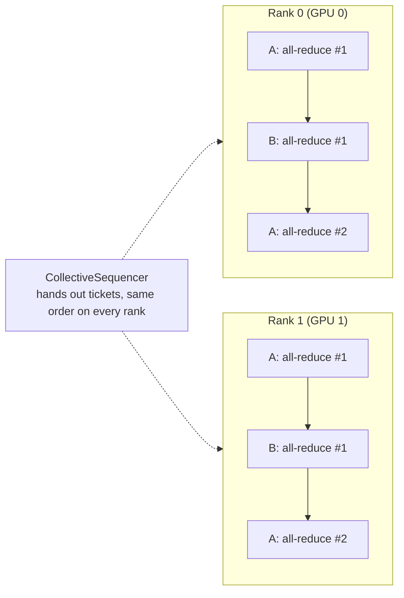

- **Solution:** A process-wide **CollectiveSequencer** puts all collectives of all models into one
  order that is the same on every rank. **Deadlocks are ruled out.**
- **Price:** Two models never communicate at the same time. With both busy, throughput splits roughly
  in half. You do **not get twice the work**; you get **the second model without waiting**.

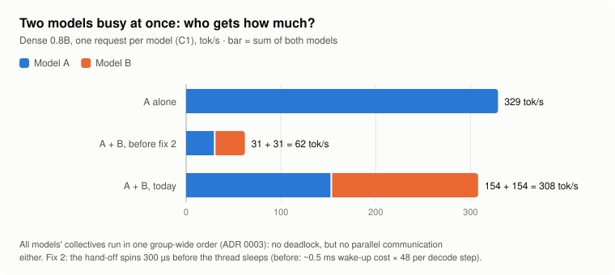

- **Fix 2 in detail:** The hand-off between the rank threads used `condition_variable::wait`. Sleeping
  and waking cost ~0.5 ms, 48 times per decode step. The thread now spins for 300 µs before it
  sleeps: **5× the throughput** per model.

---

## 10. Host RAM: budget and sizing

**The most common planning mistake:** an active model's weights are in memory **twice**, on the card
and in the prepared store.

**Rule of thumb:**

```
RAM  ≳  Σ store copies of the models you want warm
      + Σ host pools of the models active together (streaming models need more)
      + staging of the largest load (up to 4 GiB)
      + --host-headroom-mib (4096 by default)
      + whatever page cache you still want
```

**What happens when the budget (`cache.host_budget_mib`) runs out:**

1. The **prepared** model idle the longest drops out of the store and becomes `cold` (LRU).
2. Then the store copy of an **active** model (it keeps running, but is cold after deactivation).
3. If it still does not fit, the activation is refused with a **503** **before** anything is
   allocated. The kernel's OOM killer never gets involved.

**Measured (170 GiB host, Qwen3.8-Flash-Next):**

| Setup | Host RAM in use |
|---|---|
| Flash-Next prepared (store 72.5 GB) | 75 GiB |
| Flash-Next active, store copy kept | **153 GiB** |
| Two Flash-Next entries active | **160 GiB** (only the first one in the store) |

---

## 11. Measurements

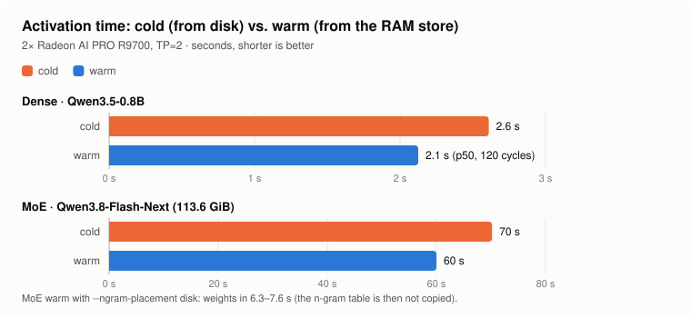

| Situation | Result |
|---|---|
| Manifest with one model vs. `--model` | no measurable difference (−0.3 % … +0.1 %) |
| Switching between two **active** models | 0 ms activation, < 1 ms queue |
| Dense 0.8B cold / warm | 2.6 s / 2.1 s (only 0.25 s of that is weights) |
| MoE cold / warm (n-gram table in RAM) | 70 s / 60 s |
| MoE warm with `--ngram-placement disk` | weights in 6.3–7.6 s |
| Deactivation | 0.7 s (dense) to 1.4 s (MoE) |
| 120 activate/deactivate cycles | VRAM back to 266 MiB per card every time; no leak in queues, threads, fds |
| Output vs. `--model` | identical (greedy, seeded sampling, streaming, MTP, long prompt, abort) |

**TTFT of a dense 0.8B model, 1,700-token prompt (p50, ms):**

| Case | Queue | Activation | Prefill | TTFT |
|---|---|---|---|---|
| model active | 0.1 | 0 | 23.7 | 24.0 |
| cold | 0.5 | 1,968 | 37.9 | 2,008 |
| prepared (warm) | 0.4 | 2,125 | 28.8 | 2,155 |
| active, 32 clients on 8 sequences | 1,403 | 0 | 27.1 | 1,431 |

**How to read it:** for a model that is not active, activation is almost the whole wait. For an
overloaded model, the scheduler queue is.

---

## 12. How it differs from llama-swap

[llama-swap](https://github.com/mostlygeek/llama-swap) looks like it solves the same problem:
**one endpoint, many models, switch on demand.** The approach is fundamentally different.

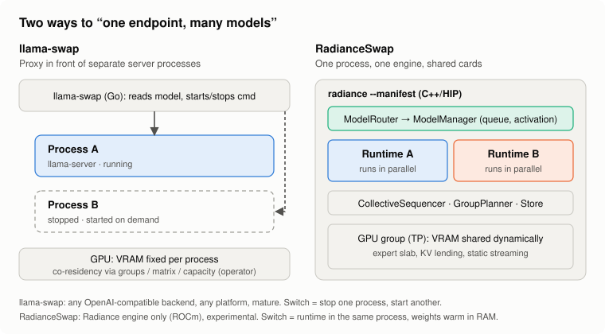

### The core principle

- **llama-swap is a proxy.** A Go program reads the `model` field, starts the matching server process
  through `cmd` (e.g. `llama-server`, vLLM, stable-diffusion.cpp) and forwards the request.
  "If the wrong upstream server is running, it will be replaced with the correct one." Switching
  means **stopping one process and starting another**.
- **RadianceSwap is an engine change.** There is **no** second process. Models are runtimes inside
  Radiance. Switching means **tearing down a runtime while the weights stay GPU-ready in RAM**.
- **Link to the design:** ADR 0001 considered exactly the llama-swap approach ("an external router
  that restarts a process per model, weights warm in the page cache", translated from German) and **rejected** it because of
  the switch latency and the extra component.

### Side by side

| Aspect | llama-swap | RadianceSwap |
|---|---|---|
| **Architecture** | External reverse proxy (Go), one binary | Inside the engine, one process (C++/HIP) |
| **Backends** | **Any** OpenAI- or Anthropic-compatible server: llama.cpp, vLLM, sd.cpp, ComfyUI and more | **Radiance only** (`.rad` or HF checkpoint) |
| **Hardware** | Whatever the backend supports: CUDA, Vulkan, Metal, CPU; Linux, macOS, Windows, FreeBSD | ROCm, Linux; tested only on AMD R9700 (gfx1201) |
| **Switch** | End the process (`unloadTimeout`, then kill), start a new one | Tear down the runtime; the next activation comes from the prepared store |
| **Warm restart** | Depends on the backend; at best the weights are in the OS page cache | Weights GPU-ready in the process's own RAM: no parsing, no relayout, no disk read |
| **Several models at once** | Default: one. More through `groups` (`swap`/`exclusive`/`persistent`), the `matrix` DSL with `evict_costs`, or `capacity` pools | Default: all of them, bounded only by the budget (`max_active_models` optional) |
| **VRAM split** | **Fixed** per process. The operator declares what fits together; `capacity` has "no automatic measurement" per its docs | **Dynamic:** expert slab, KV lending and static streaming move VRAM at runtime |
| **Model does not fit in free VRAM** | Another model has to go (eviction by group or matrix) | Starts anyway and streams the rest over PCIe; idle models can also be deactivated |
| **Running generation during a switch** | Unload is graceful with a timeout; exact behavior not checked here | **Never cut**; deactivation waits |
| **Multi-GPU** | Up to the backend (e.g. TP in vLLM) | One GPU group with TP for all models; the CollectiveSequencer prevents deadlocks |
| **Host RAM** | Not managed | Budget with LRU, admission check before allocating (503 instead of an OOM kill) |
| **Output** | Backend output passed through unchanged | Bit-identical to `--model`, measured |
| **Operations** | Web UI with playground, log streaming, aliases, request filters, profiles, preload hooks, API keys | `/radiance/models`, per-model Prometheus metrics, TTFT split, Grafana dashboard |
| **Maturity** | Established; its README says it is used by "thousands of people"; ready-made Docker images | Experimental, one test system |
| **License** | MIT | Apache-2.0 (derived from Radiance) |

llama-swap details are taken from its README and `docs/config.example.yaml` (November 2026).

### Which one to use

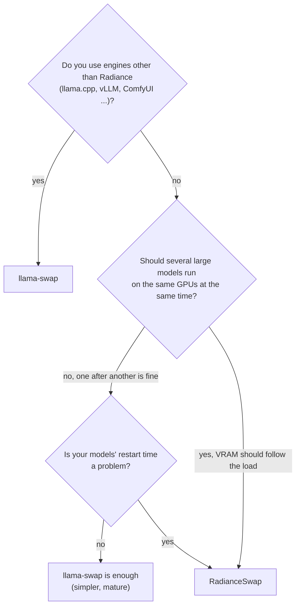

- **Choose llama-swap** if you mix backends, run on NVIDIA, Apple or CPU, need a stable tool, or want
  the web UI.
- **Choose RadianceSwap** if you run Radiance on AMD cards, want large MoE models side by side, and
  need switches in seconds rather than minutes.
- **Combine them** (hypothesis, not tested): Radiance speaks the OpenAI API, so llama-swap could run a
  RadianceSwap process as one of its upstreams, for example next to a llama.cpp server on other
  hardware.

### What was not compared

- **No shared benchmarks:** llama-swap has not been measured on the same hardware. A claim like
  "RadianceSwap switches faster" is well-founded by the design for the **warm** case (no parsing, no
  relayout), but **not measured directly**.

---

## 13. Limits and open points

| Point | Status |
|---|---|
| **One TP size per GPU group.** Plugins that only run with `--tp 1` (e.g. LFM2) can't join a TP=2 group. | Known limit |
| **A cold model still reserves a VRAM share.** A large MoE can be ~9 % slower even if the second model never activates ([#56](https://github.com/Code000-211/RadianceSwap/issues/56)). Workaround: `--gpu-headroom-mib` per model. | Measured, not fixed |
| **Large MoEs need a lot of host RAM.** One Flash-Next active and prepared uses ~153 of 170 GiB. | Measured |
| **A second active model costs ~10 %**, even while idle (tapes are bypassed while several engines are registered). | Measured, cause known |
| **Not in manifest mode:** LoRA adapters, `/v1/videos`, WebSocket sessions. | Deliberate limit |
| **`gpu_group.devices`** is checked but not yet used to pick cards. | Known limit |
| **Slab error "no finite logit":** caused by re-mapping the same address in the driver; fixed by giving every chunk fresh address space (30 load cycles, 5,776 requests, 0 errors). A long-run check is still open ([#58](https://github.com/Code000-211/RadianceSwap/issues/58)). | Fixed, long-run check open |
| **Narrow test coverage:** one MoE, small dense models, one system. Not checked: more than two models, MoE/MoE with `host_budget_mib`. | Open |

---

## 14. Quick start

`models.json`:

```json
{
  "gpu_group": { "devices": [0, 1], "tp": 2 },
  "cache": { "idle_timeout_ms": 300000, "warmup_budget_mib": 12288 },
  "models": [
    { "id": "big",   "path": "/models/big-moe.rad", "default": true,
      "engine": ["--placement", "expert_tiered", "--max-model-len", "16384"] },
    { "id": "small", "path": "/models/small",
      "engine": ["--max-model-len", "16384"] }
  ]
}
```

Start the server:

```bash
radiance --manifest models.json --port 8000
```

Pick a model per request:

```bash
curl localhost:8000/v1/chat/completions -H 'Content-Type: application/json' \
  -d '{"model": "small", "messages": [{"role": "user", "content": "hi"}]}'
```

See every model's state:

```bash
curl localhost:8000/radiance/models
```

- `engine` takes the usual Radiance options per model and validates them like the command line.
- An unknown key in the manifest stops the startup, so a typo is never a silent default.
- Full reference: [`docs/GUIDE.md`](../GUIDE.md) §4.12.

---

## 15. Sources in this repository

| Document | Contents |
|---|---|
| [`SPEC.md`](../../SPEC.md) | Original specification with 46 user stories (German) |
| [`GLOSSARY.md`](../../GLOSSARY.md) | Terms (German) |
| [`docs/adr/`](../adr/) | Decisions: in-process (0001), several active models (0002), parallel runtimes (0003) |
| [`docs/swap/`](../swap/) | Design notes: elastic slab, KV lending, static streaming, host budget, heat warm-up |
| [`docs/swap/gpu-acceptance.md`](../swap/gpu-acceptance.md) | Every GPU measurement, with setup and scripts |
| [`docs/GUIDE.md`](../GUIDE.md) §4.12 | Operator reference: manifest, lifecycle, sizing, metrics |

Please report bugs as an issue with your manifest, command line, GPU(s), ROCm version and server log.
